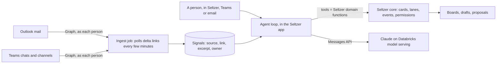

# The Seltzer agent

**Status: draft for discussion (2026-11-17).** Nothing here is built yet.

Decided so far:

- Context comes from **Outlook email and Teams** first.
- The agent **creates draft cards and helps with triage**. It never changes a published card or a
  board itself. Everything beyond a draft is a suggestion that a person applies with one tap,
  whether it came from a conversation, an email or a Teams message.

Seltzer gets one assistant that anyone on a team can talk to: in Seltzer, in Teams, or by email. It
plans with you: it turns what arrives in your inbox and chats into draft cards, triages Maybe?,
answers "what's going on?", and warns about stalled work. It also shapes each team's board. It
proposes columns, fields, rules and views that fit how that team works, and the team accepts or
rejects them. It works with Seltzer's primitives (cards, lanes, events, people) and the hook points
in [docs/mods.md](mods.md), never around them.

## Principles

The first four follow Linear's [Agent Interaction Guidelines](https://linear.app/developers/aig).

1. **The agent is a visible member of the workspace.** It has its own identity and badge, says it
   is an agent, and uses the same actions people use. Every change it makes is recorded in the
   event log under its name and can be undone.
2. **Delegate, don't assign.** A card's assignee is always a person. The agent can be added as a
   delegate working on that person's behalf, because an agent cannot be held accountable.
3. **Every piece of work is a visible session.** When the agent takes something on, it shows a
   session with its state (waiting for you, working, done, failed) on the card or in the panel.
   Silence is never a state.
4. **Acknowledge at once.** A light "working on it" appears immediately, and longer work reports
   progress.
5. **It sees only what the asking person can see.** It works through each person's own access: their
   boards, their mailbox, their chats. It never uses the app's wider access to read anything.
6. **Outside content is data, never instructions.** An email can contain text aimed at the agent.
   Because the agent can only draft and suggest, such text can never change a board by itself.

## How it fits together

Everything runs inside the Databricks workspace, as the spec requires. The agent loop lives in the
Seltzer app, the ingest job is a Lakeflow job like the sweep, and Claude is served through the
workspace's model serving.

## Talking to the agent

| Where | How | When |
| --- | --- | --- |
| Seltzer | A side panel on every screen, plus "Ask the agent" on a card | M1 |
| Email | Forward or CC a team mailbox (for example `seltzer@company`); the agent replies by email | M2 |
| Teams | A Seltzer bot in chats and channels | M2. Needs a small relay, because the Apps sign-in proxy stands between Teams and the app (spike) |

## What the agent can do

The agent's tools are Seltzer's own domain functions, generated from the same Pydantic schemas as
the REST API. The UI, the API, a future MCP server and the agent all share one surface. The agent
reads, drafts and suggests. People apply.

| The agent does it | The agent suggests, a person applies |
| --- | --- |
| Read within the asking person's access: search cards, read a card, board summary, timeline, who is working on what | Place a card in a column, or send it back to Maybe? |
| Answer questions and plan from that ("what should I pick up today?", "what moved this week?") | Assign an owner, add tags |
| Create draft cards, private to the person, from a conversation, an email or a Teams message | Postpone a card that looks stale, or close one that looks finished |
| Link a source message to a draft or a card | Merge a likely duplicate |
| | Change a team's columns, fields, rules or views (a change set, accepted by a board admin) |

Drafts are recorded with the agent as the actor and stay invisible to everyone else until their
owner publishes them. A suggestion that is applied is recorded with the person who applied it as
the actor, so accountability stays with people.

### Help with triage

Triage is where the agent earns its place. For every card in Maybe?, drafts and published cards
alike, it prepares suggestions, each with a one-line reason:

- the column to place it in
- an owner
- tags
- likely duplicates or related cards
- "this looks stale, move to Not Now?"

Suggestions show as a small marker on the card tile and in full in the card sheet. Each one can be
applied or dismissed with one tap. A **triage pass** in the side panel walks through Maybe? one card
at a time: apply, change, or skip. Dismissed suggestions teach nothing yet; they simply go away.

## Context from email and Teams

**What it reads**

- **Email:** the person's inbox, or folders they choose. Uses the delegated Microsoft Graph
  `Mail.Read` permission.
- **Teams:** chats the person is in (delegated `Chat.Read`), and channels the person picks
  (delegated `ChannelMessage.Read.All`, which needs admin consent).

It does not use Microsoft's tenant-wide export APIs (`getAllMessages`). Those take application
permissions over every mailbox and chat and are intended for compliance tools
([Teams API licensing](https://learn.microsoft.com/en-us/graph/teams-licenses)).

**How it reads**

Each person connects their Microsoft account once, through an Entra app registration with those
delegated scopes. Their refresh token is stored encrypted, with the key held in a Databricks
secret scope, and disconnecting deletes it.

An ingest job polls each connected person's Graph delta links every few minutes. It polls rather
than receiving Graph push notifications, because those would have to reach the app through its
sign-in proxy (spike).

**What it keeps**

- **The signal:** one `signals` row per message that looks like work. It holds the source, a link
  back, the sender, the time, the subject and a short excerpt. Seltzer never copies the mailbox.
  The agent fetches the full text on demand, with the owner's token.
- **Who sees it:** a signal belongs to the person whose mailbox or chat it came from. It reaches a
  board only when that person publishes a draft card that links it.
- **Retention:** signals never linked to a card are deleted after 30 days (proposed).

**Screening**

A first pass decides whether a message is work worth a draft card: a request, a bug, a decision, a
deadline. Most mail is not. Drafts land in the person's Maybe? with a summary, the suggested board,
owner and duplicates, and a link back to the thread. Seltzer's existing drafts are private to
their author, which is exactly the visibility this needs.

## Shaping each team's workflow

A team can ask the agent to set its board up: "we triage customer escalations from email and
promise a reply in two days", for instance. The agent proposes a **change set**: columns, fields,
rules and saved views, previewed on the board. A board admin accepts it, and it is recorded as
events, so the whole set can be reverted in one step.

Change sets are built from data, not code:

- columns
- fields and rules, using the `after`, `schedule` and `fields` hooks from
  [docs/mods.md](mods.md)
- saved views, assembled from a fixed kit of UI components

The agent never generates free-form UI code. Every team's board stays recognisably Seltzer, and
nothing it adds can break the board.

## The model and the loop

- **Model:** Claude Opus 5.5 (`claude-opus-5-5`) with adaptive thinking. Set the effort explicitly
  (its default is `medium`): `low` for quick chat and screening, `high` for planning and change
  sets. Whether a cheaper model should screen high-volume email is a cost decision to make after
  measuring.
- **Where it is served:** through the Anthropic Python SDK pointed at Databricks model serving's
  Anthropic Messages API (beta), so prompts and data stay under the workspace's governance
  ([Databricks docs](https://docs.databricks.com/aws/en/machine-learning/model-serving/query-anthropic-messages)).
  Which Claude models the workspace can serve is a spike; the fallback is the Anthropic API
  directly.
- **The loop:** hosted in the Seltzer backend, using the Messages API with tools. The tools must run
  as the requesting person inside the app, and the spec keeps everything inside the workspace.
  Anthropic's hosted agents (Managed Agents) would run the loop outside the workspace, so they are
  not proposed.
- **Robustness:**
  - Tool schemas are strict.
  - Ingested text is passed as tool results, never as instructions.
  - A refusal stop reason gets a polite "I can't help with that" rather than a silent failure.
  - Every run is a session row whose state the UI shows.

## Data model additions

| Table | Purpose |
| --- | --- |
| `users.kind` | `person` or `agent`, so the agent appears in stamps, timelines and filters |
| `card_delegates` | The agent working on a card on behalf of its assignee |
| `agent_sessions` | One row per piece of work: who started it, card or board, state, timestamps |
| `agent_messages` | The conversation and tool calls of a session, for the panel and for audit |
| `microsoft_connections` | Per-person Graph connection: scopes, encrypted refresh token, delta links |
| `signals`, `card_signals` | Ingested messages, and their links to cards |
| `suggestions` | One row per suggestion: card, kind (place, assign, tag, duplicate, postpone, close), the change, a reason, and its status (open, applied or dismissed) |
| `change_sets` | Proposed workflow changes: contents, status, who accepted, events produced |

## Milestones

1. **M1: the agent in Seltzer.**
   - **Scope:**
     - side panel, agent identity and visible sessions
     - read tools over today's domain functions
     - draft cards from a conversation
     - triage suggestions with one-tap apply, and the triage pass
     - no outside context yet
   - **Done when** a person can ask "what should I pick up today?", get a draft card from "the
     export is timing out for Acme, write it up", and clear Maybe? by applying or dismissing
     suggestions.
2. **M2: email and Teams.**
   - **Scope:** Microsoft connection, the ingest job, signals, screening into private draft cards,
     the team mailbox, and the Teams bot behind its relay.
   - **Done when** a request sent by email or in a Teams chat shows up as a draft in the right
     person's Maybe? within minutes, with a link back and no other person able to see it.
3. **M3: team setup by conversation.**
   - **Scope:** change sets built on the first hooks from [docs/mods.md](mods.md) (`after`,
     `schedule`, `fields`) and saved views.
   - **Done when** a team can describe its process and accept a working board setup without
     anyone editing settings by hand.

## Spikes

- **Claude on Databricks:** which Claude models the workspace's model serving offers through the
  Anthropic Messages API, and whether streaming, strict tools and refusal fallbacks work there.
- **Databricks user authorization:** the agent's reads and writes in Seltzer can use the person's
  identity, but user tokens expire, so background ingestion needs another identity.
- **Microsoft Graph in your tenant:**
  - an Entra app registration
  - admin consent for `ChannelMessage.Read.All`
  - storing refresh tokens under company policy
  - delta query behaviour for chats
- **Reaching the app from outside:** whether Teams bot traffic or Graph notifications can reach a
  Databricks App, or need a relay (for example a small Azure Function holding a service-principal
  token).
- **Prompt injection:** a test set of hostile emails, run before M2 ships.

## Open decisions

1. **Team mailbox or personal mailboxes first?** The team mailbox needs one consent and is easier
   to govern. Personal mailboxes catch more but need every person to connect.
2. **Retention of unlinked signals:** 30 days is proposed.
