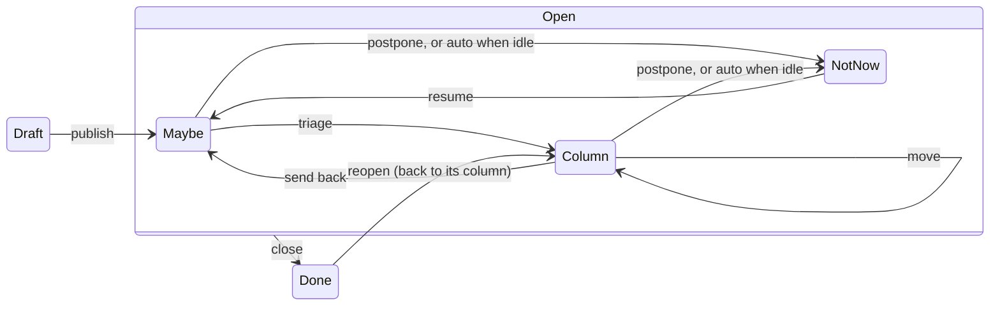
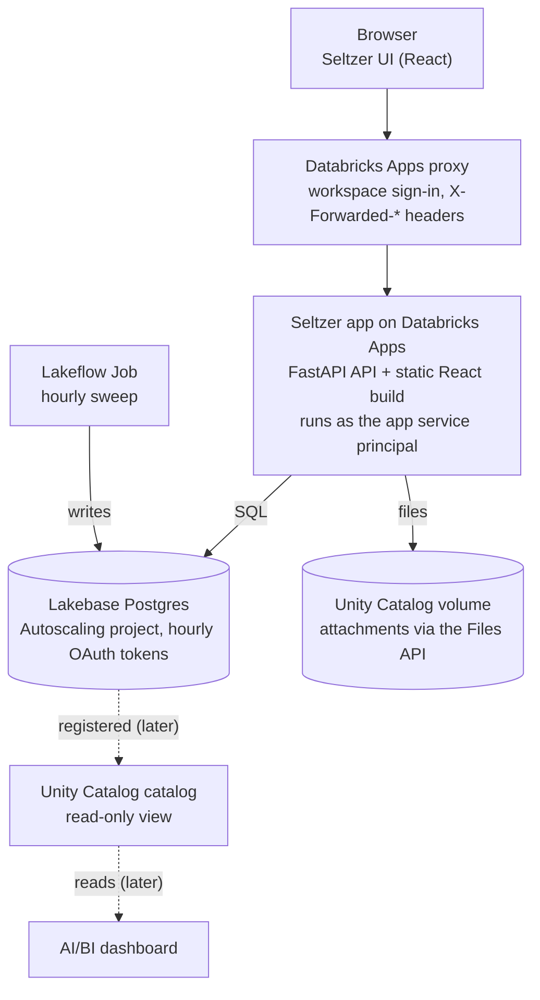

# Seltzer: architecture and spec

Exported from the design doc on 2026-11-04, with the open product questions decided and the
gaps found while building v1 closed. Sections marked **Changed in the build** differ from the
original draft; the reasons are in [Rough edges resolved](#rough-edges-resolved).

## Overview

Seltzer is a kanban tracker for issues and ideas that follows Fizzy's user experience closely and
runs entirely inside Databricks: a FastAPI + React app on Databricks Apps with Lakebase as its
database.

**Goals**

- **Feels like Fizzy.** Same core ideas: a triage stream, Not Now, auto-postpone, golden tickets
  and stamps, at the same speed and density.
- **Databricks-native.** Nothing runs outside the workspace. One bundle deploys the app, database
  and jobs.
- **No login system to build.** Identity comes from Databricks workspace sign-in.
- **Data you can analyse.** Card history is queryable from the lakehouse for reporting.

**Design principles**

- **Clean room.** Fizzy and Kan are references for behaviour and UX only. No code, templates, CSS
  or icons are copied (see [Clean-room rules](#clean-room-rules)).
- **Opinionated defaults over settings.** Pick sensible behaviour and expose few knobs.
- **Fast by default.** A board loads in one request, and moves and edits update the screen before
  the server confirms.
- **Boring technology.** Postgres, REST and one deployable app. New moving parts need a reason.

**Not in v1:** native mobile apps, guests from outside the workspace, AI features, sprints, Gantt
charts, time tracking, imports from Trello or Jira, and public boards.

## Decisions

| Question | Decision |
| --- | --- |
| Lakebase Autoscaling or Provisioned? | **Autoscaling**, for scale-to-zero and per-environment branches. Each bundle target gets its own project. |
| Who is the first owner? | **Members of a Databricks group** (`SELTZER_OWNER_GROUP`, default `admins`) become owners when they sign in. Membership is re-checked at most hourly. Promotion is automatic; demotion is an in-app action. |
| Public boards? | **Dropped.** Databricks Apps always require workspace sign-in, and all-access boards already mean "everyone in Seltzer can see it". |
| One Seltzer per workspace, or several spaces? | **One per workspace** (no tenant column), as the scope table already assumed. |
| Card numbers per workspace or per board? | **Per workspace** (Fizzy's way), so `/cards/42` is unique. |
| Rich-text format | **Tiptap JSON**, validated on the server against a node and mark allowlist; plain text is derived for search. |
| Attachment size and previews | **25 MB** default (`SELTZER_MAX_UPLOAD_MB`), **no thumbnails** in v1. Images and PDFs open inline in a sandbox; everything else downloads. |
| Board layout | **Fizzy's two-lane board.** Maybe? stays open beside one lane you choose; every other lane folds into a strip that still takes drops. Cards are never placed by hand: they land on top of whatever lane they're dropped on, and lanes sort by activity. |
| Out-of-app notifications | Still open; comes after v1 (Slack or Teams webhooks, or SMTP from a secret). |

## Product concepts

Seltzer adopts Fizzy's vocabulary as-is, because the vocabulary is the UX: cards flow from Maybe?
through coloured columns to Done, and anything ignored drifts into Not Now on its own.

| Concept | What it means in Seltzer |
| --- | --- |
| Board | One stream of work. Either open to everyone in Seltzer or limited to named people. |
| Maybe? | The triage stream. New cards land here with no column until someone places them. |
| Column | A workflow stage the board's admins define, each with its own colour. |
| Not Now | Parked cards, moved there by hand or automatically after inactivity. |
| Done | Closed cards, recording who closed them and when. |
| Auto-postpone | A card nobody touches for the board's period drifts to Not Now. A "closing soon" warning appears at 75% of the period. |
| Golden ticket | A card marked as important. It sorts to the top of its column. |
| Stalled | A card that had a burst of activity, then went quiet for 14 days. **Later.** |
| Stamp | A visible record of who filed, moved or closed a card, and when. |
| Steps | Checklist items on a card. |
| Tags, assignees, mentions | Labels, owners and @-mentions on cards and comments. |
| Watch | Follow a card or a board to get its notifications. |
| Pin | A personal shortlist of cards, visible only to you. |
| Reactions | Quick responses on comments. |
| Draft | A card still being written, visible only to its author. |
| Webhook | Pushes card events to Slack, Teams or any URL. **Later.** |

**Key screens**

1. Home: your boards, pinned cards, and an activity timeline grouped by day.
2. Board: lanes sit in a fixed row: Not Now, Maybe?, the coloured columns, then Done. Only two
   are open at once on a wide screen: Maybe? and the lane you focus on. The rest fold into narrow
   strips showing their name and count, and opening one folds the last. On a phone, one lane is
   open at a time. Each board remembers your open lane. Drop a card on any lane, open or folded,
   to move it there. Filters cover open, golden and closing soon, plus assignee and tag.
3. Card: title, rich-text description, steps, tags, assignees, attachments, comments with
   reactions, and the stamp trail. Actions: move, Not Now, Done, gild, pin, watch, delete.
4. Notifications: a tray that stacks updates per card, so ten edits read as one item.
5. Settings: board access, auto-postpone period, columns and colours; workspace members, roles and
   the default period.
6. Search: across card titles, descriptions and comments, from the top bar (`/` focuses it).

## Card lifecycle



Postponing, by hand or automatically, sends a card to Not Now and clears its column; resuming
returns it to Maybe?. Closing keeps the column, so reopening puts the card back where it was.

- Auto-postpone applies to every published, active card (in Maybe? or a column) that nobody has
  touched for the board's period. The default is 30 days, with choices from 3 to 365. "Closing
  soon" shows once 75% of the period has passed.
- Touching a card means any action that records an event. Each one updates `last_active_at`.
- Golden is a flag, not a state. It survives moves and state changes until someone removes it.
- **Cards are never placed by hand** (changed to match Fizzy). Every lane lists golden cards
  first, then the most recently active. A move is an event that touches the card, so a card
  dropped on a lane lands on top, busy cards rise, and quiet ones sink until auto-postpone moves
  them to Not Now. Dropping a card back on its own lane changes nothing.
- Any lane takes a card from any other. Into a column from Not Now or Done resumes or reopens it
  on the way; Done to Maybe? reopens it there; Done to Not Now postpones it. Each step is recorded.
- **Changed in the build:** cards can be deleted by their author or a board admin. The event log
  keeps their history (a `deleted` event with the number and title).
- **Changed in the build:** deleting a column sends its open cards to Maybe?; done cards forget the
  column and reopen into Maybe?.

## Scope

v1 is the full Fizzy card lifecycle on one board screen; integrations, live push and analytics come
after.

| Capability | Phase | Note |
| --- | --- | --- |
| Boards, columns and column colours | v1 | Reorder columns from board settings |
| Cards: drafts, rich text, tags, assignees, steps | v1 | |
| Maybe?, Not Now, Done and reopen | v1 | The core lifecycle |
| Golden tickets | v1 | |
| Auto-postpone with "closing soon" warning | v1 | Period per board, workspace default 30 days |
| Stamps and daily activity timeline | v1 | Built from the event log |
| Comments, mentions, reactions | v1 | |
| Attachments | v1 | Stored in a Unity Catalog volume |
| Filters, sorting, search | v1 | Postgres full-text and trigram search |
| In-app notifications, watching, pins | v1 | Stacked per card |
| Board access and workspace roles | v1 | |
| Stalled-card detection | Later | Needs an activity-burst detector in the sweep |
| Webhooks to Slack or Teams | Later | |
| Live updates between open browsers | Later | v1 refetches on focus and polls every 10 s |
| Email or Slack digests | Later | No Databricks-native email service |
| Board analytics dashboard | Later | AI/BI dashboard over card events |
| MCP server for agents | Later | |
| Import from Trello, Jira or Kan | Later | |
| Public boards | Not doing | Databricks Apps require sign-in |
| Native mobile apps and web push | Not doing | |
| Own login (magic links, passkeys) | Not doing | Workspace sign-in replaces it |
| Billing and multi-tenant accounts | Not doing | One deployment per workspace |

## Architecture



The Apps proxy signs people in and adds identity headers. The app then reaches Lakebase and the
attachments volume as its own service principal, and the hourly job writes to the same database.
Nothing runs outside the workspace. One Declarative Automation Bundle deploys the app, database
project, volume and job.

## Data model

Seltzer runs on one Lakebase Postgres database. A card's state lives in a single `state` column
plus a nullable `column_id`, and every change also appends a row to `events`, which feeds stamps,
the timeline, notifications and analytics.

**Decisions**

- IDs: UUIDv7 generated in the app, so they sort by time on any Postgres version. Cards also get a
  workspace-wide `number` from a sequence, for URLs like `/cards/42`.
- Ordering: cards have no position. Lanes sort by `golden_at is null`, then `last_active_at`
  descending (migration `0002`). Columns, steps and pins use fractional-index strings, so a drag
  updates one row; those keys use `COLLATE "C"` to sort bytewise, and the API takes neighbours
  (`above`, `below`) rather than raw keys.
- Triage is implied: an active card with no `column_id` is in Maybe?. Not Now clears the column;
  Done keeps it. Check constraints ensure Not Now cards and drafts have no column.
- Events are append-only and written in the same transaction as the change they describe.
- Every write that changes the board screen bumps `boards.version` in the same transaction.
- Migrations: Alembic with SQLAlchemy 2 models; `alembic check` in CI keeps them in step.

| Table | Purpose | Key columns |
| --- | --- | --- |
| `users` | Workspace people who have opened Seltzer | `databricks_user_id`, `email` (unique, case-insensitive), `display_name`, `role` (owner, admin, member), `active`, `last_seen_at`, `roles_synced_at` |
| `workspace_settings` | Single-row defaults | `default_auto_postpone_days` (30) |
| `boards` | Boards | `name`, `all_access`, `auto_postpone_days` (null = default), `created_by`, `archived_at`, `version` |
| `board_access` | Who can see a restricted board | `board_id`, `user_id` |
| `board_watches` | Who follows a board | `board_id`, `user_id` |
| `columns` | Workflow stages | `board_id`, `name`, `color`, `position` |
| `cards` | Cards | `number`, `board_id`, `column_id`, `title`, `description` (Tiptap JSON), `description_text`, `status` (draft, published), `state` (active, not_now, done), `state_changed_at`, `state_changed_by`, `auto_postponed`, `golden_at`, `last_active_at`, `published_at`, `created_by`, `version`, `search` (generated tsvector) |
| `steps` | Checklist items | `card_id`, `body`, `position`, `completed_at`, `completed_by` |
| `tags`, `card_tags` | Labels, workspace-wide | `name` (unique, case-insensitive), `color` |
| `assignments` | Card owners | `card_id`, `user_id`, `assigned_by` |
| `comments` | Discussion | `card_id`, `author_id`, `body` (Tiptap JSON), `body_text`, `edited_at`, `search` (generated tsvector) |
| `reactions` | Responses on comments | `comment_id`, `user_id`, `emoji` |
| `attachments` | Files in the Unity Catalog volume | `card_id`, `comment_id`, `volume_path`, `filename`, `content_type`, `bytes`, `uploaded_by` |
| `events` | The stamp and activity log | `board_id`, `card_id` (set null on delete), `actor_id` (null = Seltzer), `action`, `details` (jsonb), `created_at` |
| `watches` | Who follows a card | `card_id`, `user_id` |
| `pins` | Personal shortlist | `user_id`, `card_id`, `position` |
| `notifications` | Inbox rows, stacked per card in the UI | `user_id`, `card_id`, `event_id`, `reason` (watching, assigned, mentioned), `read_at` |

Event `action` values: `published`, `triaged`, `moved`, `sent_back_to_triage`, `postponed`,
`auto_postponed`, `resumed`, `closed`, `reopened`, `gilded`, `ungilded`, `assigned`, `unassigned`,
`tagged`, `untagged`, `title_changed`, `description_changed`, `board_changed`, `commented`,
`step_added`, `step_completed`, `step_uncompleted`, `attached`, `deleted`.

## API

The backend is a JSON REST API under `/api`, built with FastAPI and Pydantic. Each lifecycle change
has its own endpoint, so rules and events live in one place, and one call returns a whole board.
Interactive docs are at `/api/docs`.

**Conventions**

- The OpenAPI schema generates the TypeScript types (`frontend/openapi.json` →
  `src/api/schema.d.ts`); CI fails if either copy drifts.
- The current user is resolved once per request from the Databricks identity headers.
- Lists that grow without bound (Not Now, Done, the timeline, notifications) use cursor pagination.
- Errors use `application/problem+json`. Conflicting writes return 409; card edits that send a
  stale `version` get `current_version` back.
- `GET /api/boards/{id}?since=<version>` returns 204 when nothing changed, so polling is cheap.
- Card writes return the updated tile plus the people it references.

| Method and path | Purpose |
| --- | --- |
| `GET /api/me` | Current user, role, unread count and workspace default period |
| `GET /api/users` · `PATCH /api/users/{id}` | People, and role or active changes (admins; owners for owners) |
| `GET /api/settings` · `PATCH /api/settings` | Workspace default auto-postpone period |
| `GET /api/tags` · `POST /api/tags` · `PATCH`/`DELETE /api/tags/{id}` | Workspace tags |
| `GET /api/boards` · `POST /api/boards` | List and create boards (with optional starting columns) |
| `GET /api/boards/{id}?since=` | Board snapshot: columns, open cards, your drafts, counts, people, tags |
| `PATCH /api/boards/{id}` | Rename, access mode, auto-postpone period, archive |
| `GET`/`PUT /api/boards/{id}/access` | Restricted board access list |
| `PUT`/`DELETE /api/boards/{id}/watch` | Follow a board |
| `POST /api/boards/{id}/columns` · `PATCH`/`DELETE /api/columns/{id}` | Create, rename, recolour, reorder and delete columns |
| `GET /api/boards/{id}/cards?view=&tag=&assignee=&sort=&cursor=` | Filtered card lists (open, maybe, not_now, done, golden, closing_soon, drafts) |
| `POST /api/boards/{id}/cards` | Create a card (draft or published) |
| `GET`/`PATCH`/`DELETE /api/cards/{number}` | Card detail, edits (title, description, board), delete |
| `POST /api/cards/{number}/publish` | Publish a draft into Maybe? |
| `POST /api/cards/{number}/triage` | Move into a column, landing on top; works from any lane |
| `POST /api/cards/{number}/untriage` | Move to Maybe?, from a column, Not Now or Done |
| `POST /api/cards/{number}/postpone` · `/resume` | Not Now (from any lane), and back to Maybe? |
| `POST /api/cards/{number}/close` · `/reopen` | Done, and back |
| `PUT`/`DELETE /api/cards/{number}/golden` | Gild and ungild |
| `PUT`/`DELETE /api/cards/{number}/tags/{tag}` · `/assignees/{user}` | Tags and assignees |
| `PUT`/`DELETE /api/cards/{number}/watch` · `/pin` · `GET /api/pins` | Personal follow and shortlist |
| `POST /api/cards/{number}/steps` · `PATCH`/`DELETE /api/steps/{id}` | Steps |
| `POST /api/cards/{number}/comments` · `PATCH`/`DELETE /api/comments/{id}` | Comments |
| `PUT`/`DELETE /api/comments/{id}/reactions/{emoji}` | Reactions |
| `POST /api/cards/{number}/attachments` · `GET`/`DELETE /api/attachments/{id}` | Upload, download (streamed after a board-access check), remove |
| `GET /api/events?board=&before=` | Activity timeline |
| `GET /api/notifications` · `POST /api/notifications/read` | Inbox stacked per card, and mark as read |
| `GET /api/search?q=&board=` | Search across cards and comments |

## Identity and permissions

Databricks decides who can open Seltzer, and Seltzer decides what they can see inside it. Anyone
granted CAN USE on the app is a Seltzer user; boards and roles are enforced by the app itself.

**Who gets in**

- Grant CAN USE on the app to a Databricks group (the bundle's `users_group`, default
  `seltzer-users`). People sign in with normal workspace sign-in; there is no login page.
- The Apps proxy passes `X-Forwarded-User`, `X-Forwarded-Email` and
  `X-Forwarded-Preferred-Username` on every request. Seltzer upserts the person into `users` on
  first sight.
- Members of `SELTZER_OWNER_GROUP` (default `admins`) become owners. The app's service principal
  looks up group membership through SCIM, at most once an hour per person.
- Locally, `SELTZER_DEV_USER_EMAIL` (or an `X-Seltzer-Dev-User` header) stands in for the proxy.
  That path is ignored unless `SELTZER_ENV` is `local` or `test`.

**Which identity touches data**

- Seltzer uses app authorization: the app's service principal holds the Lakebase role and the
  volume grant. On-behalf-of-user tokens are not needed, because Seltzer data is not governed per
  user in Unity Catalog.

**Inside Seltzer**

| Role | Can do |
| --- | --- |
| Owner | Everything an admin can, plus grant and change the owner role. At least one active owner must remain. |
| Admin | Manage people and workspace settings, rename and delete tags, administer any board. |
| Member | Create boards, work on any board they can see, administer boards they created. |

- All-access boards are visible to every Seltzer user. Restricted boards are visible to the people
  on their access list, their creator, admins and owners.
- Drafts are visible only to their author.
- Notifications and assignments only reach people who can see the board.
- Deactivated people get a 403 until an admin restores them.

## Background work, live updates and notifications

Scheduled sweeps run as a Lakeflow Job, request-time work runs inside the request's transaction,
and v1 keeps screens fresh by polling. There is no message queue.

**Scheduled sweeps (Lakeflow Job)**

- An hourly serverless job runs the `seltzer-sweep` entry point from the backend wheel. It
  auto-postpones due cards; later it detects stalled cards and builds digests.
- It connects to Lakebase directly and reuses the domain code, so a sweep writes the same
  `auto_postponed` events as a person would.
- A Postgres advisory lock makes overlapping runs harmless, and the sweep only touches cards that
  are still due, so retries are safe. The job also gives run history and failure alerts.
- **Changed in the build:** the job finds its database host from the endpoint name and connects as
  its own identity. Until it runs as the app's service principal, `SELTZER_DB_GRANT_ROLES` grants
  its Postgres role access to Seltzer's tables after each migration.

**Request-time side effects**

- A lifecycle change writes the card update, its event, the board version bump and the
  notifications for watchers, assignees and mentioned people in one transaction.
- Webhooks (later) are sent after commit, with retries recorded in a table.

**Live updates**

- v1: the board refetches when the tab regains focus and polls every 10 seconds with
  `?since=<version>`. An unchanged board costs one primary-key lookup and a 204.
- Spike: server-sent events through the Apps proxy, with Postgres `LISTEN/NOTIFY` to reach every
  app instance.

**Notifications**

- In-app tray only. Notifications stack per card, so ten updates to one card read as one item.
- Card and board watchers and assignees hear about lifecycle changes, assignments and comments;
  @-mentioned people always hear; actors never notify themselves.
- Creating or commenting on a card watches it.

## Files, search and analytics

**Attachments**

- One managed volume per target, declared as an app resource with `WRITE_VOLUME`.
- Apps don't mount `/Volumes`, so the backend uses the SDK's Files API.
- Uploads stream through FastAPI to
  `boards/{board_id}/cards/{card_id}/{attachment_id}/{filename}`. Downloads stream back only after
  a board-access check, because volume grants belong to the app, not to people.
- Filenames are sanitised; images and PDFs open inline under a sandboxing CSP, and everything else
  downloads with `nosniff`.

**Search**

- **Changed in the build:** a generated column can't span tables, and Tiptap JSON isn't text. Cards
  and comments each keep a plain-text copy (`description_text`, `body_text`) derived by the app,
  with a generated, weighted `tsvector` and a GIN index on each table.
- `pg_trgm` word similarity handles typos in titles, plus a plain substring match.
- Results carry a highlighted snippet from the description or the matching comment.

**Analytics (later)**

- Registering the Lakebase database in Unity Catalog creates a read-only catalog that serverless
  SQL warehouses and dashboards can query.
- An AI/BI dashboard over `events` can show throughput, time spent per column, and how much work
  gets auto-postponed, with no extra pipeline.

## Frontend

A React + TypeScript single-page app built with Vite into `backend/seltzer/static`, so one app
process serves both the UI and the API. Every component is ours; Fizzy is the visual reference,
not a source.

| Concern | Choice | Why |
| --- | --- | --- |
| Build | Vite | Fast dev server; static output FastAPI serves |
| Routing | TanStack Router | Typed routes for boards and card numbers |
| Server data | TanStack Query | Optimistic moves, refetch on focus, polling |
| API client | openapi-fetch with generated types | Types stay in sync with the backend |
| Drag and drop | dnd-kit | Proven for kanban |
| Rich text | Tiptap | Mentions and links; stored as JSON, rendered without HTML strings |
| Primitives | Radix UI | Accessible menus, dialogs and popovers |
| Styling | Tailwind CSS on our own design tokens | Light and dark themes from one token set |

Components: BoardCanvas (the two-lane board: open lanes, folded strips, drop-anywhere moves), CardTile, Stamp, CardSheet (lazy-loaded with the editor), Composer,
NotificationTray, FilterBar, SearchBox, BoardSettings, Timeline, Avatar.

## Deployment and environments

One Declarative Automation Bundle (`databricks.yml`) deploys everything, with `dev` and `prod`
targets.

**Bundle resources**

- `postgres_projects.seltzer`: a Lakebase Autoscaling project per target (`seltzer-dev`,
  `seltzer-prod`), Postgres 17. Prod has `prevent_destroy`.
- `volumes.attachments`: a managed volume per target.
- `apps.seltzer`: source `./backend`, `python -m seltzer.serve`, Medium compute, the Postgres
  resource (`CAN_CONNECT_AND_CREATE`), the volume (`WRITE_VOLUME`) and CAN USE for the users group.
  **Changed in the build:** the app's command and environment live in the bundle's app `config`
  rather than a static `app.yaml`, because the Lakebase endpoint differs per target.
- `jobs.sweep`: hourly, serverless, a Python wheel task built from `./backend`.

**Database connection**

- Lakebase OAuth tokens expire after an hour. The pool fetches a token with
  `w.postgres.generate_database_credential(endpoint=…)` whenever it opens a connection, and caches
  it until ten minutes before expiry. Open connections stay valid.
- Connection settings come from `PGHOST`, `PGDATABASE`, `PGUSER`, `PGPORT`, `PGSSLMODE` (set by the
  database resource) and `ENDPOINT_NAME` (set in the bundle).
- Autoscaling can scale to zero, so the pool pre-pings connections and the first query after an
  idle spell can take a few seconds.

**Environments**

| Environment | Database | Purpose |
| --- | --- | --- |
| Local | Postgres 16 in Docker (`docker compose up -d`) | Fast loop with fake identity headers |
| dev | The `seltzer-dev` Lakebase project | Shared testing, preview of migrations |
| prod | The `seltzer-prod` Lakebase project | Real use |

**Migrations and CI**

- Alembic runs at app startup under a Postgres advisory lock, so only one instance migrates.
- GitHub Actions: ruff, mypy, pytest against Postgres, `alembic check`, drift checks for
  `requirements.txt` and the OpenAPI types, frontend type-check, tests and build, then
  `databricks bundle deploy -t dev` on merge to `main`. Prod deploys are manual.

## Open questions and spikes

The product questions are settled (see [Decisions](#decisions)) except out-of-app notifications.
These spikes need a real workspace; the code is written so each is a configuration change, not a
rewrite.

- [ ] **Lakebase from FastAPI**: confirm token rotation and the scale-to-zero wake time; confirm
  the default branch (`production`), endpoint (`primary`) and database resource
  (`databricks-postgres`) ids the bundle variables assume, and which `PG*` variables the Postgres
  app resource injects; confirm the app's role can `CREATE EXTENSION pg_trgm`.
- [ ] **Job identity**: run the sweep as the app's service principal (set `run_as`) or keep its own
  identity and list its role in `SELTZER_DB_GRANT_ROLES`.
- [ ] **Owner group lookup**: confirm the app's service principal can read group membership
  through SCIM (`users.list` with the `groups` attribute).
- [ ] **Attachments via the Files API**: upload and download a 25 MB file through the app and
  measure speed.
- [ ] **SSE on Databricks Apps** (for later live updates): confirm events stream through the
  proxy, and that `LISTEN/NOTIFY` works on the Lakebase endpoint.

## Rough edges resolved

Gaps in the draft spec found while building v1, and how each was closed.

| Rough edge | Resolution |
| --- | --- |
| Search over comments used one generated `tsvector`, but generated columns can't span tables and Tiptap JSON isn't text | Plain-text copies on cards and comments, one generated `tsvector` per table, results unioned |
| Fractional-index keys sort wrongly under locale collations | `COLLATE "C"` on every position column |
| Board `version` for polling wasn't in the data model | `boards.version`, bumped in each write transaction; 204 when unchanged |
| "409 with the current version" had no version to compare | `cards.version`; `PATCH` takes the version it read |
| Board watching lived on `board_access`, which all-access boards don't have | Separate `board_watches` table |
| Tag, description and new-step changes recorded no event, so they wouldn't reset the auto-postpone clock | Added `tagged`, `untagged`, `description_changed`, `step_added`, `step_uncompleted` |
| Card and column deletion were unspecified | Card delete keeps history via a `deleted` event; column delete sends open cards to Maybe? |
| Stalled filter and bubble were on v1 screens but Later in scope | Removed from v1 screens |
| Concurrent drags could compute the same position key | Cards no longer have positions; for columns, steps and pins the API takes neighbours and the server places between adjacent rows |
| Many endpoints the screens need were missing (people, tags, steps, comments, reactions, column delete, board watch, pins, settings) | Added; see the API table |
| The sweep job runs as a different identity from the app, which owns the tables | Role grants after migrations; `run_as` the app's service principal once it exists |
| Per-target settings (the Lakebase endpoint) can't live in a static `app.yaml` | App `config` in the bundle |
| Notifications and assignments could reach people who can't see a restricted board | Recipients and assignees are filtered by board access |

## Clean-room rules

Seltzer borrows ideas from Fizzy and Kan, never code. Fizzy's O'Saasy license bars offering it as a
competing hosted service, and Kan's AGPL-3.0 would pass to any code copied from it. This is not
legal advice; check with counsel before offering Seltzer to outside customers.

- Behaviour comes from using Fizzy and from this spec. Reading Fizzy's source to understand a rule
  is fine; writing code from it line by line is not.
- No copied code, templates, CSS, icons, illustrations or long UI copy from either project. Short
  common labels such as "Not Now" are fine.
- Every component, style and asset in the repo is written for Seltzer.
- `NOTICE` credits Fizzy and Kan as inspiration and links them.

## Repo layout

```
seltzer/
  databricks.yml          # bundle: app, Lakebase project, volume, job, targets
  docker-compose.yml      # local Postgres
  backend/
    seltzer/
      api/                # FastAPI routers and Pydantic schemas
      domain/             # lifecycle rules, events, permissions, read models
      db/                 # SQLAlchemy models, Lakebase pool
      jobs/sweep.py       # auto-postpone sweep (the job's entry point)
      static/             # built UI (generated, not committed)
    migrations/           # Alembic
    tests/
    requirements.txt      # what Databricks Apps installs (exported from uv.lock)
  frontend/               # React + Vite, built into backend/seltzer/static
  docs/spec.md            # this document
  CLAUDE.md               # build brief for Claude Code
  NOTICE
```
